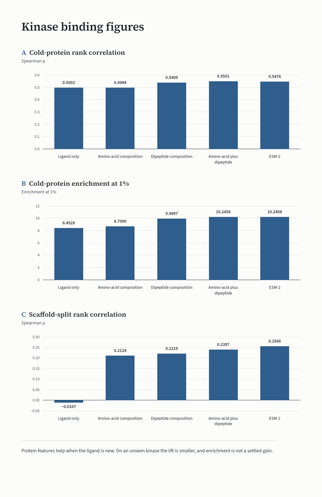

# Ranking Public Kinase-Ligand Affinities With and Without Protein Features

Sofia Lindelow. 2026-10-03.

A score for one protein-ligand pair was tested for whether it can order a public compound library for one kinase, and for whether that order uses the protein or only the ligand. On the saved splits, amino-acid plus dipeptide composition beats a ligand-only control when scaffolds are held out, and it adds a smaller lift when whole proteins are held out (cold-protein Spearman rho 0.5501 versus 0.5002; enrichment at 1% 10.2458 versus 8.4528). A graph model did not keep that cold-protein lift. The composition lift transferred to KIBA on Spearman rho, not on enrichment at 1%. A warm library rank for LCK recovered known binders far above chance, and a cold rank for SLK did not beat ligand-only on the broader ranks. The scores are predictions on public labels. They are not wet-lab hits.

The full write-up, with every number taken from the exported tables, is [RESEARCH_REPORT.md](RESEARCH_REPORT.md).



## Repo map

- [README.md](README.md): this page, including how to check the saved scores.
- [RESEARCH_REPORT.md](RESEARCH_REPORT.md): the full write-up. Reported numbers there are the exported tables.
- [figures/kinase-binding-figures.png](figures/kinase-binding-figures.png): cold-protein and scaffold-split figure.
- [artifacts/metrics_uncertainty.md](artifacts/metrics_uncertainty.md): bootstrap intervals from the saved scores.

## Data

- DAVIS pairs, the primary labels, downloaded from Therapeutics Data Commons via Harvard Dataverse file 5219748: https://dataverse.harvard.edu/api/access/datafile/5219748. Papers already cited in the report: Davis et al. 2011 (https://doi.org/10.1038/nbt.1990) and Huang et al. 2021, Therapeutics Data Commons.
- KIBA, the secondary table. The TDC Dataverse file returned HTTP 403, so the frozen table came from the DeepDTA public mirror: https://github.com/hkmztrk/DeepDTA/tree/master/data/kiba. Papers: Tang et al. 2014 (https://doi.org/10.1021/ci400709d) and Öztürk et al. 2018 (https://doi.org/10.1093/bioinformatics/bty593). The three KIBA files over 100 MB (`data/raw/kiba_pairs.csv`, `data/splits_kiba/cold_protein_split.csv`, and `data/splits_kiba/scaffold_split.csv`) are not in the repo. The smaller DeepDTA text files that are in the repo (`data/raw/kiba_deepdta/ligands_can.txt`, `data/raw/kiba_deepdta/proteins.txt`, and `data/raw/kiba_deepdta/kiba_binding_affinity_v2.txt`) came from that same mirror.
- The screening library is a Murcko subsample of MoleculeNet HIV plus the 68 DAVIS ligands. HIV activity labels were not used. Source file: https://deepchemdata.s3-us-west-1.amazonaws.com/datasets/HIV.csv

## Data licenses

The MIT text in [LICENSE](LICENSE) covers this repository's code. It does not cover the data files.

- DAVIS, via Therapeutics Data Commons, Harvard Dataverse file 5219748. The TDC drug-target page lists the DAVIS dataset license as "Not Specified" and links [CC BY 4.0](https://creativecommons.org/licenses/by/4.0/): https://tdcommons.ai/multi_pred_tasks/dti/#davis. Papers already cited in the report: Davis et al. 2011 and Huang et al. 2021.
- KIBA, from the DeepDTA public mirror, because the TDC file returned HTTP 403: https://github.com/hkmztrk/DeepDTA/tree/master/data/kiba. That repository has no LICENSE file. Papers already cited: Tang et al. 2014 and Öztürk et al. 2018. TDC's own KIBA entry, which this repo did not download, also lists the license as "Not Specified" and links CC BY 4.0: https://tdcommons.ai/multi_pred_tasks/dti/#kiba.
- MoleculeNet HIV, the CSV at https://deepchemdata.s3-us-west-1.amazonaws.com/datasets/HIV.csv. Wu et al. 2018 (https://doi.org/10.1039/C7SC02664A), already cited in [docs/process/RESEARCH_PACK.md](docs/process/RESEARCH_PACK.md), describe this table as the NCI Drug Therapeutics Program AIDS Antiviral Screen. The MoleculeNet code repository is MIT (https://github.com/deepchem/moleculenet) and does not contain this CSV. This note does not assign the CSV a license of its own. HIV activity labels were not used.

## What held up

The working scorer is a histogram gradient booster on Morgan fingerprints, plus amino-acid composition and dipeptide composition. On the saved DAVIS splits, those protein features beat a ligand-only control when scaffolds are held out, and they add a smaller lift when whole proteins are held out (cold-protein Spearman 0.5501 vs 0.5002). A Chemprop graph model did not keep that cold-protein lift. The same features transferred to KIBA on Spearman, not on enrichment at 1%. A one-pair selectivity check (SRC vs LCK) was positive, and ligand-only could not rank it. A warm screen of LCK looked strong because that kinase was in training. A cold screen of SLK stayed above chance, and ligand-only won the broader ranks.

## Reproduce

```bash
uv venv --python 3.12 .venv && source .venv/bin/activate
uv pip install -e .
./reproduce.sh
```

`reproduce.sh` checks the v1 metrics within 1e-4. Later shell entry points that exist are `reproduce_v1.1.sh`, `reproduce_v1.2.sh`, and `reproduce_v1.4.sh`. There is no `reproduce_v1.3.sh`, `reproduce_v1.5.sh`, or `reproduce_v1.6.sh`. The matching Python scripts in the tree are `scripts/run_kiba_v1.3.py`, `scripts/run_calibration.py`, `scripts/run_screen_v1.5.py`, and `scripts/run_screen_v1.6.py`. Raw DAVIS tables, the KIBA pair table, the ESM cache, and the KIBA split CSVs are on disk in this working copy and are listed in `.gitignore`, so a public commit should not include them. Manifests under `data/` record the source files and hashes. Rebuilding the KIBA splits needs the frozen pair table, which is also gitignored because it is over GitHub's 100 MB file limit.

## What is not claimed

No new binder. No prospective screen. No external concordance check. See the Discussion in [RESEARCH_REPORT.md](RESEARCH_REPORT.md).

## Verify

From the project root, with the existing `.venv`:

```bash
.venv/bin/python scripts/uncertainty_bootstrap.py
```

That command does not refit any model. It reads saved scores only and rewrites `artifacts/metrics_uncertainty.json` and `artifacts/metrics_uncertainty.md`. It also refreshes section 6 of `docs/process/STAT_REVIEW.md`.

The cold-protein histogram comparison is one of those saved-score checks. `artifacts/scores_histgbm_cold_protein.csv` stores per-pair ligand-only and amino-acid-plus-dipeptide scores for the frozen DAVIS cold-protein test (5,168 pairs, 76 kinases). [RESEARCH_REPORT.md](RESEARCH_REPORT.md) and [artifacts/metrics_uncertainty.md](artifacts/metrics_uncertainty.md) report the Spearman difference 0.0500 with a 95% kinase-cluster bootstrap interval of 0.0271 to 0.0720 (two-sided p = 0.001 in the report; the metrics table prints 0.0010). That interval excludes 0. The same sources report the enrichment-at-1% difference 1.7930 with a 95% interval of -0.2624 to 3.2468 (two-sided p = 0.091 in the report; the metrics table prints 0.0909). That interval includes 0. The script resamples held-out kinases from the CSV. It does not impute the interval from the aggregates in `artifacts/metrics_v1.1.json`.

The interval can also be recomputed for the graph model, because `artifacts/models_v1.2/preds_cold_protein_protein.npz`, `preds_cold_protein_ligand_only.npz`, `preds_scaffold_protein.npz`, and `preds_scaffold_ligand_only.npz` store per-pair scores. It can also be recomputed for the SLK recovery comparison, because `artifacts/screen_ranked_cold.csv` stores both scores and the known-binder flag.

It cannot be recomputed for the histogram amino-acid-plus-dipeptide versus ligand-only comparison on the DAVIS scaffold split. Those per-pair scores were not saved. The same is true for KIBA: `artifacts/metrics_kiba.json` has aggregates, not per-pair scores. The script skips those comparisons and does not impute an interval. The KIBA cold-protein difference of 0.0609 stays a point estimate.

`./reproduce_v1.2.sh` retrains the graph model and can replace the npz files above. Run the read-only checks first if those saved scores should stay as they are.

A reviewer recomputes the ranking math in this order:

1. `src/vs/metrics_lib.py` is the Spearman rho and enrichment definition used by the training scripts.
2. `./reproduce.sh` runs `scripts/run_train_eval.py` and `scripts/check_metrics_tolerance.py`, refits the first DAVIS models, and writes `artifacts/metrics.json`.
3. `./reproduce_v1.1.sh` runs `scripts/run_protein_ablation.py` and refits the histogram protein-feature comparison. It writes `artifacts/metrics_v1.1.json`. Cold-protein per-pair scores from the saved fit are already in `artifacts/scores_histgbm_cold_protein.csv`. `scripts/score_histgbm_cold_protein.py` does not refit. It loads the joblibs in `artifacts/models_v1.1/`, scores the frozen cold-protein test, and rewrites that CSV only if Spearman rho and enrichment at 1% match the exported point estimates within 1e-4. It does not rewrite `artifacts/metrics_v1.1.json`. Those joblib files are committed. `.gitignore` does not exclude `artifacts/models_v1.1/`. Regenerating the CSV also needs `data/raw/davis_pairs.csv`, which `.gitignore` does exclude. The bootstrap in step 7 reads the saved CSV and does not need that raw table.

```bash
.venv/bin/python scripts/score_histgbm_cold_protein.py
```

4. Graph-model Spearman rho and enrichment, without refitting, from the four saved npz files. Run this from the project root after `pip install -e .` so `vs` imports. `./reproduce_v1.2.sh` (`scripts/run_chemprop_v1.2.py`) is the refit path for the same metrics and is not required to check the saved scores.

```bash
.venv/bin/python - << 'PY'
import numpy as np
from vs.metrics_lib import compute_metrics
files = [
    "artifacts/models_v1.2/preds_cold_protein_protein.npz",
    "artifacts/models_v1.2/preds_cold_protein_ligand_only.npz",
    "artifacts/models_v1.2/preds_scaffold_protein.npz",
    "artifacts/models_v1.2/preds_scaffold_ligand_only.npz",
]
for path in files:
    z = np.load(path)
    m = compute_metrics(z["y_true"], z["y_pred"], 7.0, [0.01, 0.05])
    print(path, {k: round(m[k], 4) for k in ("spearman_rho", "ef_at_1pct", "ef_at_5pct", "auroc")})
PY
```

5. `scripts/run_kiba_v1.3.py` refits KIBA and is the only way to recompute that Spearman rho and enrichment. Per-pair scores are not saved, so there is no interval.
6. `scripts/run_screen_v1.6.py` refits the SLK screen. The saved table is `artifacts/screen_ranked_cold.csv`. Recovery on that table, including the new intervals, is step 7. The LCK table `artifacts/screen_ranked.csv` has scores but not a known-binder flag, and no ligand-only recovery table was exported, so that warm-screen comparison is not bootstrapped.
7. `.venv/bin/python scripts/uncertainty_bootstrap.py` writes the bootstrap intervals from the saved histogram cold-protein scores, the saved graph scores, and the saved SLK table.
